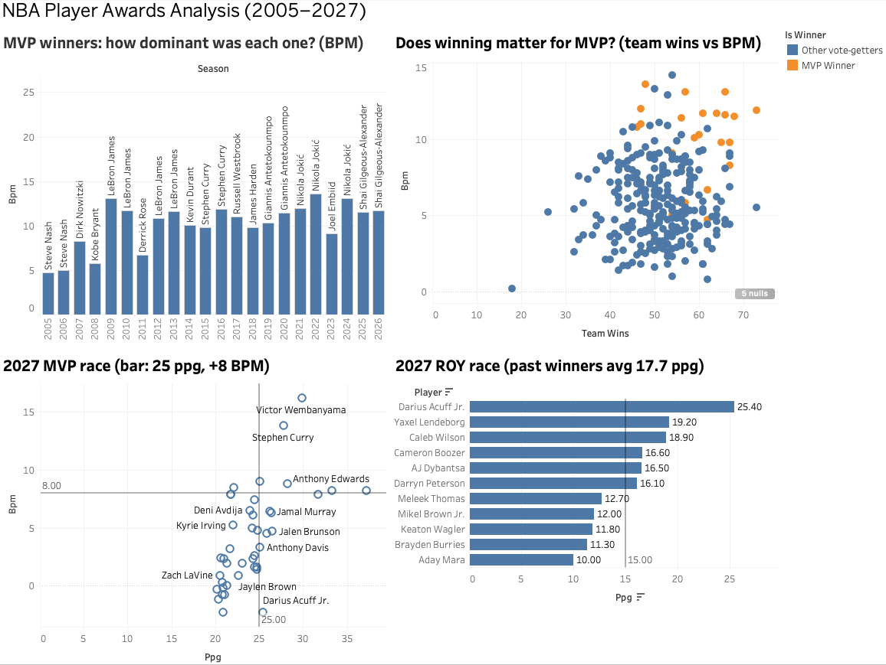

# NBA Player Awards Analysis (2005–2027)

What does it take to win an NBA award, and who is on track this season?

This project looks at 22 seasons of NBA player awards (MVP, DPOY, ROY, 6MOY, MIP, Clutch Player, All-NBA, All-Defensive and All-Star). It finds the statistical profile of past winners, then checks this season's players against those benchmarks.

**Live dashboard:** [NBA Awards Analysis on Tableau Public](https://public.tableau.com/app/profile/kunal.rane2343/viz/NBAAwardsAnalysis_17954818013530/Dashboard)



## Tools
- **Python** to download and load the data
- **SQLite + SQL** (VS Code with SQLTools) to clean and analyze it
- **Tableau Public** for the dashboard

## Data
All stats come from [Basketball-Reference](https://www.basketball-reference.com) (per-game stats, advanced stats and team records for the 2005 to 2027 seasons). The raw data is not included in this repo. Run `scripts/get_data.py` to download it yourself.

The 2027 season was in progress (about 17 games in) when the data was pulled in November 2026.

## Database
Three clean tables built from the raw downloads:

| Table | Rows | What it holds |
|---|---|---|
| `player_season` | 11,532 | One row per player per season with basic and advanced stats plus team record |
| `awards` | 2,376 | One row per player per award per season, with voting finish |
| `team_season` | 690 | One row per team per season |

The full ERD and column guide are in `docs/NBA_Awards_Database_Guide.docx`.

## Key findings
**MVP**
- The average MVP season: 27.6 ppg, +10.1 BPM and 59 team wins.
- No MVP since 2005 played on a team with fewer than 46 wins.
- 14 of 22 MVPs had the league's best BPM, and 13 of 22 played on the team with the best record.

**Defensive Player of the Year**
- 15 of 22 winners were centres. Only one guard won (Marcus Smart, 2022).

**Rookie of the Year**
- Winners usually come from losing teams: the average was 31 wins, the most was 52.
- Kevin Durant (16), Chris Paul (12), Damian Lillard (9) and Kyrie Irving (9) made the most All-Star teams after winning ROY.

**Sixth Man and Most Improved**
- The typical Sixth Man is a 28-year-old bench scorer (17 ppg) on a 53-win team. Lou Williams and Jamal Crawford won it 3 times each.
- Most Improved winners jumped from 13.1 to 20.7 ppg on average, mostly from getting about 7 more minutes a game.

**All-NBA**
- LeBron James leads with 21 selections, 13 of them First Team.
- Since the 65-game rule started in 2024, the fewest games by an All-NBA player went from 45 to 64.

**This season (2027, early)**
- MVP: Wembanyama, Jokić, Giannis and Luka pass all three MVP benchmarks (25+ ppg, +8 BPM, .560+ win %).
- DPOY: Wembanyama leads with 5.2 steals + blocks a game on an .824 team.
- ROY: Darius Acuff Jr. leads rookies at 25.4 ppg.

These are benchmarks based on past winners, not predictions. Voters also weigh things like narrative and games played.

## Repo structure
```
scripts/
  get_data.py            download stats from Basketball-Reference
  load_to_sqlite.py      load the CSVs into SQLite
  export_for_tableau.py  export clean tables for Tableau
sql/
  01_build_tables.sql    build the 3 clean tables
  02_mvp.sql to 10_all_star.sql   analysis for each award
  11_mvp_tracker.sql     2027 MVP benchmark check
  12_dpoy_roy_tracker.sql  2027 DPOY and ROY benchmark check
docs/
  NBA_Awards_Database_Guide.docx  ERD and table guide
```

## How to run it
1. `python3 scripts/get_data.py`
2. `python3 scripts/load_to_sqlite.py`
3. Run `sql/01_build_tables.sql` against `nba_awards.db`
4. Run any of the analysis files in `sql/`
5. `python3 scripts/export_for_tableau.py` for the dashboard data
